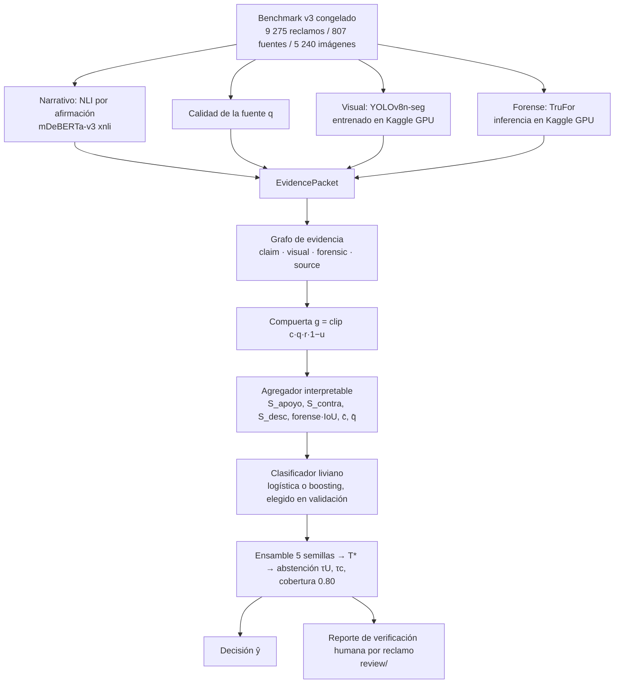

# UAFEG: grafo de evidencia con compuerta de confiabilidad y verificación humana

Repositorio de modelos de la tesis de Ana María Accilio Villanueva (UTEC). El problema, los datos,
los especialistas y las métricas están en el repositorio hermano
[vehicle-claim-verification-baselines](../vehicle-claim-verification-baselines/README.md) (Repo A);
aquí está la propuesta: representar la evidencia de un reclamo vehicular (relato + foto) como un
grafo, ponderar cada pieza con una compuerta de confiabilidad g y decidir `SUPPORTED`,
`SUSPICIOUS` o `INSUFFICIENT`, con calibración, abstención y un reporte para revisión humana.

Los reclamos son **escenarios controlados sobre imágenes reales** (HITL, CC0): las fotos son
reales, pero los relatos y las manipulaciones se generan por programa con etiqueta conocida. No
son expedientes de una aseguradora; es el diseño de la tesis.

## Pipeline final (sin GATv2)



**GATv2 queda fuera del alcance final** (decisión del 2026-11-20). La propagación de mensajes
aprendida no se entrena ni se evalúa: con 807 fuentes y la evidencia visual tan ruidosa como la
que produce el especialista entrenado, un agregador explícito sobre las aristas del grafo es más
interpretable (cada número de la decisión se puede trazar a una arista) y permite el reporte
humano. El código GATv2 se conserva en `src/uafeg/models/p1_graph.py`, `p2_uafeg.py` y
`batched.py`, marcado como fuera del alcance.

### Comparaciones controladas

| Sistema | Qué es | Aísla |
|---|---|---|
| B6 | DeepSets sobre los mismos EvidencePacket, sin grafo | referencia sin estructura |
| G0 (= A1) | agregador sobre el grafo con g = 1 | B6 vs G0: aporte del grafo |
| G1 | agregador con compuerta g (**UAFEG final**) | G0 vs G1: aporte de la compuerta |

Hipótesis (Holm, α = 0.05): **H1** G1 vs el mejor sistema sin grafo (elegido en validación), PR-AUC
de SUSPICIOUS en test restringido a C3–C5 (positivos) frente a C8–C9; **H2** G1 vs G0 en Brier;
**H3** G1 vs A2 (G1 sin forense) en PR-AUC de SUSPICIOUS. Ablaciones: A1 = G0, A2 = sin forense,
A3 = B6, A4 = aristas sin atributos continuos, A5 = sin C8 en train (C10 nunca está en train).

<!-- RESULTS:BEGIN -->
## Resultados principales (test, evaluado una sola vez)

Ensamble calibrado (T* en validación), IC 95 % por bootstrap agrupado por `source_image_id` (2 000 réplicas). Decisión final con abstención (cobertura objetivo 0.80, τU y τc fijados en validación). Fuente: `results/evaluation.json`; tablas LaTeX en `results/final/`.

| Sistema | PR-AUC SUS ↑ | Macro-F1 ↑ | Brier ↓ | NLL ↓ | ECE ↓ | AURC ↓ | abstención |
|---|---|---|---|---|---|---|---|
| B0 (reglas) | 0.555 [0.549, 0.565] | 0.571 [0.571, 0.571] | 0.393 [0.389, 0.396] | 0.548 [0.543, 0.552] | 0.014 [0.013, 0.020] | 0.217 [0.201, 0.216] | 0.000 |
| B1 (solo texto) | 0.736 [0.721, 0.747] | 0.507 [0.488, 0.527] | 0.470 [0.463, 0.478] | 0.774 [0.761, 0.787] | 0.005 [0.000, 0.011] | 0.226 [0.216, 0.238] | 0.228 |
| B2 (solo visual+fuente) | 0.553 [0.540, 0.571] | 0.476 [0.453, 0.499] | 0.500 [0.494, 0.507] | 0.817 [0.809, 0.826] | 0.019 [0.010, 0.031] | 0.285 [0.268, 0.302] | 0.151 |
| B3 (solo forense) | 0.758 [0.742, 0.773] | 0.554 [0.536, 0.571] | 0.472 [0.463, 0.481] | 0.782 [0.768, 0.797] | 0.011 [0.009, 0.034] | 0.214 [0.202, 0.228] | 0.204 |
| B4 (concatenación+MLP) | 0.868 [0.856, 0.880] | 0.689 [0.668, 0.710] | 0.264 [0.254, 0.274] | 0.376 [0.364, 0.389] | 0.010 [0.007, 0.024] | 0.070 [0.063, 0.077] | 0.175 |
| B5 (fusión tardía calibrada) | 0.878 [0.868, 0.888] | 0.664 [0.642, 0.687] | 0.263 [0.254, 0.272] | 0.377 [0.365, 0.389] | 0.011 [0.006, 0.030] | 0.071 [0.064, 0.078] | 0.202 |
| B7 (DBF) | 0.864 [0.852, 0.875] | 0.688 [0.658, 0.715] | 0.385 [0.378, 0.392] | 0.586 [0.578, 0.595] | 0.099 [0.083, 0.117] | 0.145 [0.133, 0.157] | 0.240 |
| B8 (MLLM congelado (Qwen2-VL-2B)) | 0.438 [0.431, 0.450] | 0.398 [0.370, 0.425] | 0.600 [0.591, 0.609] | 1.006 [0.991, 1.021] | 0.072 [0.057, 0.090] | 0.366 [0.352, 0.382] | 0.239 |
| B6 (DeepSets) | 0.870 [0.859, 0.881] | 0.711 [0.691, 0.732] | 0.263 [0.255, 0.272] | 0.375 [0.365, 0.387] | 0.012 [0.005, 0.025] | 0.068 [0.062, 0.074] | 0.143 |
| G0 (agregador, g=1 (=A1)) | 0.871 [0.861, 0.882] | 0.699 [0.675, 0.721] | 0.265 [0.256, 0.275] | 0.381 [0.369, 0.393] | 0.016 [0.012, 0.033] | 0.070 [0.064, 0.077] | 0.163 |
| G1 (UAFEG: agregador con g) | 0.851 [0.838, 0.865] | 0.671 [0.647, 0.695] | 0.276 [0.267, 0.285] | 0.390 [0.378, 0.401] | 0.015 [0.007, 0.027] | 0.080 [0.072, 0.087] | 0.184 |


### Hipótesis (Holm, α = 0.05)

- **H1**: G1 vs B5 (best non-graph system by validation PR-AUC on the stress subset): diferencia -0.0388 (IC95 [-0.0530, -0.0246]), p = < 0.0005 (0 de 2000 réplicas), p_Holm = < 0.0005 (0 de 2000 réplicas) → se rechaza H0 pero en contra de G1: hipótesis RECHAZADA (el rival es mejor)
- **H2**: G1 vs G0, Brier (calibrated ensembles): diferencia -0.0104 (IC95 [-0.0192, -0.0018]), p = 0.0160, p_Holm = 0.0160 → se rechaza H0 pero en contra de G1: hipótesis RECHAZADA (el rival es mejor)
- **H3**: UAFEG (G1) vs A2 (G1 without forensic nodes): diferencia +0.0618 (IC95 [+0.0505, +0.0734]), p = < 0.0005 (0 de 2000 réplicas), p_Holm = < 0.0005 (0 de 2000 réplicas) → se rechaza H0 a favor de G1: hipótesis ACEPTADA

### Ablaciones

| Sistema | PR-AUC SUS ↑ | Macro-F1 ↑ | Brier ↓ | NLL ↓ | ECE ↓ | AURC ↓ | abstención |
|---|---|---|---|---|---|---|---|
| G1 (UAFEG: agregador con g) | 0.851 [0.838, 0.865] | 0.671 [0.647, 0.695] | 0.276 [0.267, 0.285] | 0.390 [0.378, 0.401] | 0.015 [0.007, 0.027] | 0.080 [0.072, 0.087] | 0.184 |
| A2 (G1 sin forense) | 0.789 [0.776, 0.801] | 0.579 [0.550, 0.610] | 0.319 [0.313, 0.326] | 0.445 [0.436, 0.454] | 0.005 [0.001, 0.012] | 0.122 [0.115, 0.131] | 0.237 |
| A4 (G1 aristas sin atributos) | 0.851 [0.838, 0.865] | 0.663 [0.638, 0.687] | 0.276 [0.267, 0.285] | 0.390 [0.378, 0.401] | 0.015 [0.008, 0.028] | 0.080 [0.072, 0.087] | 0.202 |
| A5 (G1 sin C8 en train) | 0.850 [0.837, 0.862] | 0.460 [0.446, 0.474] | 0.335 [0.330, 0.340] | 0.459 [0.452, 0.466] | 0.135 [0.130, 0.140] | 0.128 [0.123, 0.133] | 0.195 |


### Oráculo

| Sistema | PR-AUC SUS ↑ | Macro-F1 ↑ | Brier ↓ | NLL ↓ | ECE ↓ | AURC ↓ | abstención |
|---|---|---|---|---|---|---|---|
| G1 (UAFEG: agregador con g) | 0.851 [0.838, 0.865] | 0.671 [0.647, 0.695] | 0.276 [0.267, 0.285] | 0.390 [0.378, 0.401] | 0.015 [0.007, 0.027] | 0.080 [0.072, 0.087] | 0.184 |
| G1_oracleN (G1 oráculo narrativa) | 0.866 [0.856, 0.877] | 0.670 [0.648, 0.693] | 0.261 [0.255, 0.268] | 0.371 [0.363, 0.380] | 0.013 [0.006, 0.028] | 0.070 [0.064, 0.075] | 0.210 |
| G1_oracleVF (G1 oráculo visual+forense) | 0.943 [0.936, 0.950] | 0.733 [0.703, 0.765] | 0.159 [0.150, 0.171] | 0.244 [0.232, 0.261] | 0.014 [0.008, 0.031] | 0.026 [0.022, 0.031] | 0.200 |
| G1_oracleNVF (G1 oráculo ambos) | 0.965 [0.958, 0.971] | 0.799 [0.772, 0.826] | 0.132 [0.128, 0.136] | 0.208 [0.201, 0.215] | 0.014 [0.007, 0.030] | 0.016 [0.013, 0.018] | 0.157 |
| G0 (agregador, g=1 (=A1)) | 0.871 [0.861, 0.882] | 0.699 [0.675, 0.721] | 0.265 [0.256, 0.275] | 0.381 [0.369, 0.393] | 0.016 [0.012, 0.033] | 0.070 [0.064, 0.077] | 0.163 |
| G0_oracleNVF (G0 oráculo ambos) | 0.970 [0.964, 0.976] | 0.778 [0.748, 0.807] | 0.103 [0.093, 0.114] | 0.172 [0.158, 0.187] | 0.009 [0.006, 0.023] | 0.012 [0.010, 0.015] | 0.177 |


### Sensibilidad C2 (sin los 552 reclamos AMBIGUOS de C2–C5)

| Sistema | PR-AUC SUS ↑ | Macro-F1 ↑ | Brier ↓ | NLL ↓ | ECE ↓ | AURC ↓ | abstención |
|---|---|---|---|---|---|---|---|
| B6 (DeepSets) | 0.882 [0.871, 0.893] | 0.750 [0.726, 0.775] | 0.234 [0.223, 0.244] | 0.340 [0.327, 0.353] | 0.032 [0.022, 0.044] | 0.051 [0.045, 0.057] | 0.143 |
| G0 (agregador, g=1 (=A1)) | 0.888 [0.877, 0.899] | 0.735 [0.712, 0.764] | 0.235 [0.223, 0.247] | 0.345 [0.330, 0.360] | 0.023 [0.015, 0.039] | 0.053 [0.045, 0.060] | 0.163 |
| G1 (UAFEG: agregador con g) | 0.869 [0.854, 0.881] | 0.709 [0.677, 0.737] | 0.247 [0.237, 0.259] | 0.356 [0.343, 0.371] | 0.043 [0.035, 0.054] | 0.057 [0.050, 0.066] | 0.184 |
| B5 (fusión tardía calibrada) | 0.888 [0.879, 0.898] | 0.690 [0.665, 0.713] | 0.245 [0.235, 0.254] | 0.353 [0.341, 0.365] | 0.013 [0.008, 0.031] | 0.059 [0.052, 0.066] | 0.202 |


### Especialistas medidos (archivos reales)

| Especialista | Métrica | Valor |
|---|---|---|
| Narrativo | tipo de daño exacto / por familia / polaridad (val, n=1129) | 0.500 / 0.689 / 0.965 |
| Visual YOLOv8n-seg | máscara mAP50 / mAP50-95, val HITL (110 img) | 0.118 / 0.055 |
| | caja mAP50 / mAP50-95, val HITL (110 img) | 0.128 / 0.071 |
| Visual YOLOv8n-seg | máscara mAP50 / mAP50-95, test HITL (129 img) | 0.096 / 0.041 |
| | caja mAP50 / mAP50-95, test HITL (129 img) | 0.112 / 0.056 |
| | CarDD test (374 img), caja, clases mapeadas | 0.054 / 0.022 |
| | CarDD test, caja, daño agnóstico | 0.077 / 0.030 |
| | CarDD máscara | NOT_RUN (el espejo con licencia declarada solo trae cajas) |
| Forense TruFor | AUROC C3 vs C0 (val, imágenes) | 0.889 |
| Forense TruFor | AUROC C4 vs C0 (val, imágenes) | 0.544 |
| Forense TruFor | AUROC C5 vs C0 (val, imágenes) | 0.889 |
| | AUROC C3–C5 vs C0 (val) | 0.774 |


## Limitaciones

- Reclamos controlados sobre imágenes reales; no son expedientes de una aseguradora.
- El especialista visual es débil (ver tabla de especialistas) y la compuerta g lo atenúa fuertemente (g visual medio en C0 = 0.030).
- C3 y C5 comparten las mismas imágenes editadas; las manipulaciones son pequeñas.
- Test no completamente ciego (se miró al diseñar la QA del benchmark).
- Una sola corrida de TruFor y de YOLO (semilla 0); la varianza entre semillas solo cubre al clasificador final.
- Si G1 elige la regresión logística (convexa), sus 5 semillas coinciden y su desviación entre semillas es 0.
<!-- RESULTS:END -->

## Cómo reproducirlo

```bash
cd uafeg
make all        # verify-lock -> packets -> búsqueda -> entrenamiento -> evaluación (test una vez) -> tablas
python -m experiments.graph_stats        # estadística de grafos (sección 4)
python -m experiments.specialist_report  # especialistas
python -m experiments.human_reports      # reportes humanos + review/ + 20 errores
```

Lo pesado (YOLOv8n-seg, inferencia visual, TruFor, B8) se corrió en kernels privados de Kaggle con
GPU T4; los scripts exactos están en `../vehicle-claim-verification-baselines/scripts/kaggle/` y sus
salidas (con SHA-256 verificados) en `artifacts/specialists/` del Repo A. `experiments.thesis_evaluate`
se niega a correr dos veces (`results/test_access_log.json`).

## Organización

- `src/uafeg/thesis_graph.py`: grafo con la taxonomía de la tesis; `src/uafeg/aggregator.py`: agregador G0/G1.
- `experiments/thesis_aggregator.py`: búsqueda y entrenamiento de G0/G1/A2/A4/A5/oráculo.
- `experiments/thesis_train.py`: B1–B4, B7, B6. `experiments/b8_import.py`: B8.
- `experiments/thesis_evaluate.py`: calibración, abstención, test una vez, bootstrap, McNemar, Holm.
- `experiments/thesis_tables.py`, `graph_stats.py`, `specialist_report.py`: tablas y figuras en `results/final/`.
- `experiments/human_reports.py`: reportes humanos; `review/`: paquete de 50 casos listo para revisar.
- `docs/decisiones_cierre.md`: cada decisión del cierre, una línea por decisión.

## Citas

- HITL Car Parts and Car Damages (Humans in the Loop, CC0), Kaggle `humansintheloop/car-parts-and-car-damages`.
- CarDD: Wang, Li y Wu, IEEE T-ITS 2023 (espejo Kaggle CC BY-NC 4.0; ver `../vehicle-claim-verification-baselines/data/EXTERNAL_DATA.md`).
- YOLOv8: Jocher et al., Ultralytics, 2023. TruFor: Guillaro et al., CVPR 2023.
- mDeBERTa-v3 xnli: Laurer et al., 2022; He et al., 2021. Qwen2-VL: Wang et al., 2024.
- Temperature scaling: Guo et al., ICML 2017. Clasificación selectiva: Geifman y El-Yaniv, NeurIPS 2017.
- DeepSets: Zaheer et al., NeurIPS 2017. Holm, 1979. McNemar, 1947.
