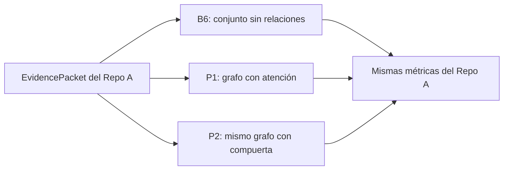

# UAFEG: grafo y modelos de la tesis

Repo B: implementa la comparación B6 → P1 → P2 usando los contratos y herramientas del [Repo A](../vehicle-claim-verification-baselines/README.md).

**B6/P1/P2 implementados, sin entrenamiento sobre el benchmark real.** La carga de datos real todavía no está implementada; `--data smoke` usa datos sintéticos. [Preparación del entrenamiento](docs/TRAINING.md).

## Comparación experimental



B6/P1 comparten codificadores y clasificador; la comparación estudia el efecto de la arquitectura de grafo. P2 reutiliza P1 y escala mensajes con `g = clip(cobertura × calidad × confiabilidad × (1 − incertidumbre), 0, 1)`. Su beneficio aún no se ha medido.

## Mapa de archivos

| Ruta | Contenido |
|---|---|
| `src/uafeg/graph.py` | Construye y valida nodos/aristas desde EvidencePacket. |
| `src/uafeg/relations.py` | Relaciones narrativa-visual a partir de señales observables. |
| `src/uafeg/models/features.py`, `encoders.py` | Características y codificadores compartidos. |
| `src/uafeg/models/b6_deepsets.py` | B6: agregación por media, sin aristas. |
| `src/uafeg/models/p1_graph.py` | P1: atención sobre el grafo. |
| `src/uafeg/models/p2_uafeg.py`, `gate.py` | P2 y compuerta de confiabilidad. |
| `src/uafeg/models/training.py`, `oracle.py` | Entrenamiento/checkpoints y controles con evidencia de referencia. |
| `experiments/` | CLI de entrenamiento/evaluación, ablaciones y datos sintéticos. |
| `configs/` | Configuraciones de modelos y ablaciones. |
| `tests/` | Pruebas de modelos, contratos y compuerta. |
| `benchmark.lock.json`, `scripts/pin_benchmark.py` | Fijan/verifican el contrato y snapshot v2 del Repo A. |
| `artifacts/` | Salidas locales, checkpoints y registros; fuera de Git. |
| `docs/IMPLEMENTATION_STATUS.md` | Auditoría técnica y diferencias respecto a la tesis; incluye antecedentes fechados. |

## Instalación y comprobación

Mantener ambos repositorios como carpetas hermanas. Desde `uafeg/`:

```bash
python3.11 -m venv .venv
.venv/bin/python -m pip install -r requirements.txt
env -u PYTHONPATH OMP_NUM_THREADS=1 MKL_NUM_THREADS=1 .venv/bin/python -m pytest -q
env -u PYTHONPATH .venv/bin/python scripts/pin_benchmark.py --check
```

## Primera corrida de desarrollo

```bash
env -u PYTHONPATH OMP_NUM_THREADS=1 MKL_NUM_THREADS=1 .venv/bin/python -m experiments.train --system B6 --config configs/b6_deepsets.yaml --data smoke --epochs 1 --checkpoint-out artifacts/checkpoints/b6-smoke.pt
env -u PYTHONPATH OMP_NUM_THREADS=1 MKL_NUM_THREADS=1 .venv/bin/python -m experiments.evaluate --system B6 --config configs/b6_deepsets.yaml --data smoke --checkpoint artifacts/checkpoints/b6-smoke.pt
```

La corrida guarda pesos y un registro, pero no produce resultados científicos. Para P1/P2 usar el sistema y configuración correspondientes. [Detalle de experimentos](experiments/README.md).

## Reglas de integración

- Importar esquemas y métricas del Repo A; nunca copiar sus definiciones aquí.
- No usar etiquetas, condiciones, IDs o rutas como entradas predictivas.
- El grafo actual tiene un nodo central de caso y un nodo por modalidad presente; no implementa aún todos los nodos/atributos del diseño del PDF.
- A1–A3 tienen implementación; A4/A5 siguen pendientes. No presentarlas como experimentos completados.
- No actualizar el lock durante una limpieza. `--write` se reserva para un cambio deliberado y revisado del contrato/versionado del Repo A.
