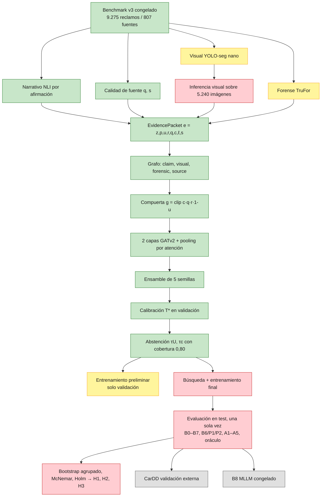
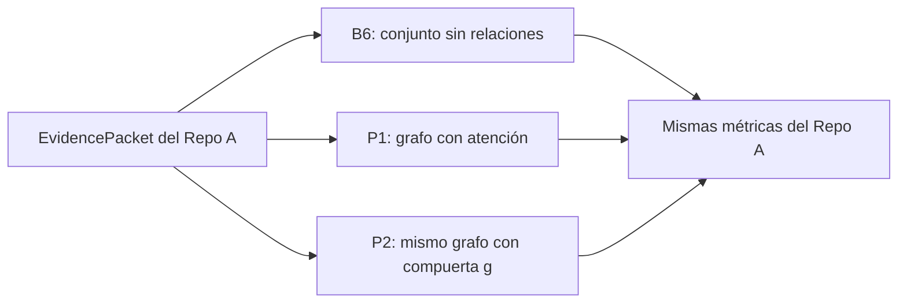

# UAFEG: grafo de evidencia con compuerta de confiabilidad

Este repositorio contiene los modelos de mi tesis. El problema, los datos, los especialistas y las métricas están en el repositorio hermano [vehicle-claim-verification-baselines](../vehicle-claim-verification-baselines/README.md); aquí está la propuesta: representar la evidencia de un reclamo (relato + foto) como un grafo y modular los mensajes según qué tan confiable es cada observación. La salida es `SUPPORTED`, `SUSPICIOUS` o `INSUFFICIENT`.

La pregunta experimental es si añadir relaciones explícitas entre modalidades y atenuar las observaciones poco confiables mejora la discriminación, la calibración y la robustez, frente a recibir exactamente la misma evidencia sin esos dos mecanismos.

## El pipeline y dónde estoy (2026-11-13)



Verde: hecho y ejecutado. Amarillo: corriendo ahora. Rojo: falta. Gris: NOT_RUN con razón explícita.

## La comparación



Los tres sistemas comparten entrada, codificadores por tipo de nodo, pooling, clasificador, espacio de etiquetas y protocolo de entrenamiento. Solo cambia lo que se quiere aislar:

- **B6 frente a P1** aísla el aporte de la estructura de grafo.
- **P1 frente a P2** aísla el aporte de la compuerta de confiabilidad.

La compuerta es `g = clip(c · q · r · (1 − u), 0, 1)`: `c` es cobertura, `q` calidad de la fuente, `r` confiabilidad del especialista (medida en validación) y `u` su incertidumbre. Todo sale de señales observables del propio `EvidencePacket`, nunca de la etiqueta ni de la condición. Con `g = 1` en todos los nodos, P2 reproduce a P1 exactamente, y hay un test que lo comprueba.

## El grafo

Uso la taxonomía de nodos de la tesis (`graph.node_taxonomy: thesis`, en `src/uafeg/thesis_graph.py`): un nodo `claim` por **afirmación** del relato, un nodo `visual` por detección de daño, un nodo `forensic` por detección de integridad y un nodo `source` con la calidad del expediente. Las aristas llevan tipo de relación y el vector `a_ij = [p_support, p_contradiction, p_unknown, sim_sem, overlap_spatial]`:

- afirmación ↔ observación visual: NLI de la afirmación frente a la clase observada, más la compatibilidad en una ontología de daños (`sim_sem`);
- visual ↔ visual y visual ↔ forense: `overlap` con el índice de Jaccard entre máscaras;
- source → observaciones: `evidence_for`, sin atributos.

Un atributo no medible vale cero con máscara cero: es un ausente declarado, no un valor medido. La taxonomía anterior (hub `claim` + un nodo por modalidad) queda como `legacy`, solo para comparar.

## La capa de mensaje

La variante `model.gat_variant: thesis` implementa el mensaje y la actualización de la tesis:

```
m_ij = g_j · α_ij · W_r h_j
h_i ← LayerNorm(h_i + σ(Σ_j m_ij))
```

Hay un `W_r` por tipo de relación, la atención consume `a_ij` y la actualización tiene residual con normalización. La compuerta escala el mensaje del vecino, nunca el `h_i` del residual. Para entrenar en CPU, `src/uafeg/models/batched.py` calcula esa misma capa por lotes usando los parámetros de `ThesisGATv2Layer` sin tocarla; `tests/test_batched_models.py` comprueba que la salida coincide grafo por grafo.

## Componentes y métodos

| Componente | Método | Referencia | Estado |
|---|---|---|---|
| B6, comparador sin relaciones | DeepSets | Zaheer, Kottur, Ravanbakhsh, Poczos, Salakhutdinov y Smola, NeurIPS 30, 2017 | Entrenado solo en validación preliminar |
| P1 y P2, atención sobre el grafo | GATv2 | Brody, Alon y Yahav, *How Attentive are Graph Attention Networks?*, ICLR 2022 | Entrenado solo en validación preliminar |
| B7, fusión con incertidumbre | Discounted Belief Fusion | Bezirganyan, Sellami, Berti-Equille y Fournier, AISTATS 2025, PMLR 258:3142–3150 | Implementación propia desde el artículo |
| Especialista forense | TruFor | Guillaro, Cozzolino, Sud, Dufour y Verdoliva, CVPR 2023, pp. 20606–20615 | Corriendo |
| Calibración | Temperature scaling | Guo, Pleiss, Sun y Weinberger, ICML 2017, PMLR 70:1321–1330 | Implementada, no aplicada a test |
| Abstención | Clasificación selectiva, riesgo-cobertura y AURC | Geifman y El-Yaniv, NeurIPS 30, 2017, pp. 4878–4887 | Implementada, no aplicada a test |
| Intervalos | Bootstrap agrupado por `source_image_id` | descrito en el `.tex`, sin cita bibliográfica | Implementado, no ejecutado sobre test |
| Comparaciones múltiples | Corrección de Holm, α global de 0,05 | descrito en el `.tex`, sin cita bibliográfica | Implementado, no ejecutado sobre test |

## Estado actual (2026-11-13)

Distingo cuatro estados: tener código, haberlo ejecutado sobre el benchmark real, haber entrenado sobre él y haber evaluado científicamente (test, una sola vez). **Test todavía no se ha evaluado** (`results/test_access_log.json` no existe).

| Componente | Implementado | Ejecutado | Entrenado | Evaluado |
|---|---|---|---|---|
| Benchmark v3 (9.275 reclamos, 807 fuentes), congelado `READY_FOR_MODELS = YES` | Sí | Sí | N/A | No |
| Criterios C2–C5 (0 inválidos, 552 ambiguos marcados) | Sí | Sí | N/A | N/A |
| Lock por hashes (git_commit informativo) | Sí | `--check` PASS | N/A | N/A |
| Narrativo NLI por afirmación (411 oraciones distintas) | Sí | Sí: polaridad 96 %, tipo de daño 47 % | Preentrenado | No |
| Calidad de fuente q, s (5.240 imágenes únicas) | Sí | Sí | N/A | No |
| Visual YOLOv8n-seg (imgsz 416, 15 épocas) | Sí | En pausa en la época 1 (~17 min/época con la CPU compartida) | No | No |
| Forense TruFor (5.240 imágenes) | Sí | Corriendo (~12 s/imagen con contención) | Preentrenado | No |
| EvidencePackets reales (train 6.428 / val 1.256 / test 1.591) | Sí | Preliminares: visual y forense en null con estado | N/A | No |
| Grafo con taxonomía de la tesis y `a_ij` | Sí | Sí | N/A | N/A |
| B6, P1, P2 y compuerta | Sí | Sí | Preliminar: solo validación, 5 semillas, ≤ 15 épocas, configuración fija | No |
| B1, B2, B4, B5, B7 | Sí | Sí | Preliminar: solo validación | No |
| B0 (reglas) | Sí | No sobre packets reales | N/A | No |
| B3 (solo forense) | Sí | No: forense aún null | No | No |
| B8 (MLLM congelado) | No | NOT_RUN | — | — |
| Ablaciones A1 (≡ P1), A2, A3 (≡ B6), A4, A5 | Sí | A4 y A5 en validación preliminar | Preliminar | No |
| Protocolo oráculo (4 combinaciones) | Sí | No | No | No |
| Calibración, abstención, bootstrap, Holm, H1–H3 | Sí | No sobre test | N/A | No |
| CarDD (validación externa) | No | NOT_RUN | — | — |
| Pruebas | Repo B: 116 en verde. Repo A: 163 en verde y 5 omitidas | | | |

Las métricas preliminares de validación se calcularon con especialistas incompletos y no son resultados de la tesis.

## Decisiones (2026-11-13)

Aprobadas por mi asesora:

- Criterios de validez C2–C5 (tabla VÁLIDO / AMBIGUO / INVÁLIDO), aplicados automáticamente donde son medibles: C2 queda en 297 válidos y 510 ambiguos, C3 en 806 / 1, C4 en 767 / 40 y C5 en 806 / 1, sin inválidos. Los ambiguos se conservan, con una marca para el análisis de sensibilidad.
- Taxonomía de nodos de la tesis por defecto en B6, P1 y P2.
- v3 congelado como benchmark oficial, con el lock reescrito con `--write` en un commit propio. v2 queda como histórico.

Mías, fijadas antes de mirar test (`configs/evaluation.yaml`):

- Cobertura operativa 0,80 para elegir τU y τc en validación.
- H1: PR-AUC de `SUSPICIOUS` en test restringido a C3–C5 (positivos) frente a C8–C9 (negativos). Compara P2 con el mejor sistema sin grafo entre B1–B5, B7 y B6, elegido en validación sobre ese mismo subconjunto. C10 se reporta aparte; ΔM por condición es secundario, fuera de Holm.
- Autoricé TruFor. El checkpoint se carga con `weights_only=True` y solo se permiten escalares de numpy.

Decisiones rápidas, una línea cada una:

- Sin monorepo por ahora (modo rápido): solo cambió el lock.
- Un solo entorno: `uafeg/.venv` es un enlace al `.venv` del Repo A.
- El lock verifica únicamente hashes; `git_commit` es informativo, y un test comprueba que alterar un archivo del contrato lo hace fallar.
- El `exclusions.json` del generador queda intacto (la regeneración determinista lo compara byte a byte); las exclusiones por criterio van en `exclusions_criteria.json`.
- El modo RGBA/RGB, el formato y el tamaño de archivo son huellas del generador en v3, así que nunca son features; los especialistas convierten todo a RGB.
- `s` (origen/EXIF) es null: ninguna imagen de v3 tiene EXIF.
- El NLI corre en float32, porque transformers cargaba el checkpoint en fp16, unas 7 veces más lento en CPU.
- La capa por lotes reutiliza los parámetros de `ThesisGATv2Layer`, con un test de equivalencia.
- A1 ≡ P1 y A3 ≡ B6 se reportan como alias, no como corridas repetidas.
- Corregí el oráculo forense: marcaba como manipulado todo reclamo con `transformation`, y en v3 todos la tienen.
- A5 quita C8 del entrenamiento. C10 ya era solo de test, así que para C10 no cambia nada.

## Limitaciones que deben ir en la tesis

- Escala reducida: YOLO nano a 416 px con 15 épocas, búsqueda de ≤ 8 configuraciones, early stopping corto, todo en CPU.
- Test no es completamente ciego: la QA del diseño del benchmark también lo miró.
- Los casos ambiguos se conservan; los resultados se reportan con y sin ellos.
- El realismo de C3, C4 y C5 no lo revisó una persona.
- El narrativo acierta el tipo de daño solo en el 47 % de las afirmaciones (la polaridad, en el 96 %). La confiabilidad `r` medida en validación lo refleja.

## Qué falta y cuánto

1. Reanudar YOLO (~3–4 h de CPU) y la inferencia visual (~30–45 min).
2. Terminar TruFor (~5–8 h si corre solo).
3. Regenerar los packets finales (~5 min).
4. Búsqueda (8 configuraciones × 3 sistemas) y entrenamiento final (5 semillas × ~15 sistemas): ~2–3 h.
5. Una sola evaluación en test, más tablas y figuras: ~20 min.
6. NOT_RUN: CarDD, porque no está disponible localmente y hay que solicitarlo y descargarlo; B8, porque no hay un MLLM abierto y reproducible que corra en 4 núcleos y 7,6 GB de RAM.

## Cómo correrlo

Uso un solo entorno, el del Repo A (`uafeg/.venv` apunta a `../vehicle-claim-verification-baselines/.venv`). Desde `uafeg/`:

```bash
make test     # suites de ambos repositorios
make smoke    # versión rápida con fixtures
make all      # verify-lock → packets → train → evaluate (T*, τU, τc, test una vez) → hipótesis → tablas
```

Cada paso falla con un mensaje claro si falta su prerrequisito (checkpoint de YOLO, packets o corridas). Para la corrida preliminar solo en validación:

```bash
env -u PYTHONPATH OMP_NUM_THREADS=1 .venv/bin/python -m experiments.thesis_train train \
  --validation-only --max-epochs 15 --systems B6 P1 P2
```

## Organización

| Ruta | Contenido |
|---|---|
| `src/uafeg/thesis_graph.py` | Grafo con la taxonomía de la tesis y la taxonomía previa |
| `src/uafeg/thesis_oracle.py` | Oráculo derivado de la procedencia |
| `src/uafeg/graph.py`, `relations.py` | Grafo previo y atributos de arista |
| `src/uafeg/models/` | Capa GATv2 de la tesis, versión por lotes, B6/P1/P2, baselines, DBF y compuerta |
| `experiments/thesis_*.py` | Cargador anti-fuga, entrenamiento, evaluación y tablas |
| `configs/evaluation.yaml` | Protocolo de evaluación fijado antes de test |
| `results/` | Resúmenes versionados (JSON pequeños, tablas, figuras) |
| `benchmark.lock.json` | Hashes del contrato de v3 |
| `artifacts/` | Checkpoints, logits y cachés, fuera de git |

## Reglas que respeta este repositorio

- Los esquemas y las métricas se importan del Repo A; nunca se copian aquí.
- Ni las etiquetas, ni la condición, ni los identificadores, ni las rutas entran como features; el constructor del grafo solo recibe la evidencia, sin el `ClaimRecord`.
- T*, τU, τc y los hiperparámetros se eligen solo en validación. Test se evalúa una vez, y cada acceso queda registrado.
- Código implementado no es lo mismo que modelo entrenado, y modelo entrenado no es lo mismo que hipótesis evaluada.
