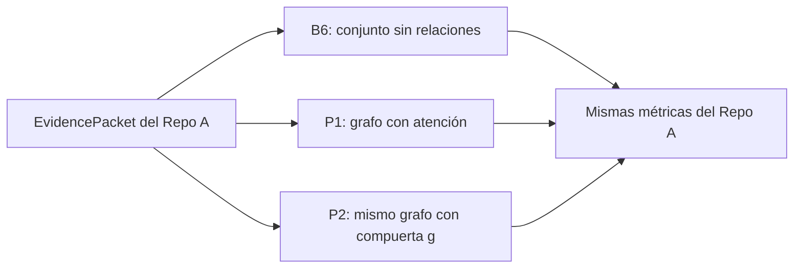

# UAFEG: grafo de evidencia con compuerta de confiabilidad

Este repositorio contiene los modelos de mi tesis. El problema, los datos y las métricas están en el repositorio hermano [vehicle-claim-verification-baselines](../vehicle-claim-verification-baselines/README.md); aquí solo está la propuesta: representar la evidencia de un reclamo como un grafo y modular los mensajes según qué tan confiable es cada observación.

La pregunta experimental es si añadir relaciones explícitas entre modalidades y atenuar las observaciones poco confiables mejora la discriminación, la calibración y la robustez, frente a recibir exactamente la misma evidencia sin esos dos mecanismos.

## La comparación



Los tres sistemas comparten entrada, codificadores, pooling por media, clasificador, espacio de etiquetas y protocolo de entrenamiento. Solo cambia lo que se quiere aislar:

- **B6 frente a P1** aísla el aporte de la estructura de grafo.
- **P1 frente a P2** aísla el aporte de la compuerta de confiabilidad.

La compuerta es `g = clip(c · q · r · (1 − u), 0, 1)`, donde `c` es cobertura, `q` calidad de la fuente, `r` confiabilidad reportada por el especialista y `u` su incertidumbre. Los cuatro factores salen únicamente de señales observables del propio `EvidencePacket`, nunca de la etiqueta ni de la condición. Con `g = 1` en todos los nodos, P2 reproduce a P1 exactamente, y hay un test que lo comprueba.

## La capa de mensaje

La variante por defecto (`model.gat_variant: thesis`) implementa el mensaje y la actualización tal como están en la tesis:

```
m_ij = g_j · α_ij · W_r h_j
h_i ← LayerNorm(h_i + σ(Σ_j m_ij))
```

Con tres propiedades que importan: hay un peso `W_r` por tipo de relación, de modo que la relación decide qué se propaga y no solo cuánto pesa el vecino; la atención consume el vector continuo de atributos de arista `a_ij = [p_support, p_contradiction, p_unknown, sim_sem, overlap_spatial]`; y la actualización tiene conexión residual con normalización. La compuerta escala el mensaje del vecino, nunca el `h_i` del residual.

Cada atributo de arista viene con una máscara de observabilidad. Un atributo que el contrato actual no permite medir vale cero con máscara cero, que es un ausente declarado y no un valor medido. Hoy `overlap_spatial` siempre está enmascarado, porque la narrativa no localiza y el resultado forense todavía no publica localización.

La variante `legacy` conserva la capa anterior, más simple, para poder medir contra ella.

## Componentes y métodos

| Componente | Método | Referencia | Estado |
|---|---|---|---|
| B6, comparador sin relaciones | DeepSets | Zaheer, Kottur, Ravanbakhsh, Poczos, Salakhutdinov y Smola, NeurIPS 30, 2017 | Implementado, sin entrenar |
| P1 y P2, atención sobre el grafo | GATv2 | Brody, Alon y Yahav, *How Attentive are Graph Attention Networks?*, ICLR 2022 | Implementado, sin entrenar |
| Compuerta de confiabilidad | Fusión multimodal con cuantificación de incertidumbre | Bezirganyan, Sellami, Berti-Equille y Fournier, AISTATS 2025, PMLR 258:3142–3150 | Implementada, sin entrenar |
| Calibración | Temperature scaling | Guo, Pleiss, Sun y Weinberger, ICML 2017, PMLR 70:1321–1330 | Implementada, no aplicada a datos reales |
| Abstención | Clasificación selectiva, riesgo-cobertura y AURC | Geifman y El-Yaniv, NeurIPS 30, 2017, pp. 4878–4887 | Implementada, no aplicada a datos reales |
| Intervalos | Bootstrap agrupado por `source_image_id` | descrito en el `.tex`, sin cita bibliográfica | Implementado, no ejecutado |
| Comparaciones múltiples | Corrección de Holm, α global de 0,05 | descrito en el `.tex`, sin cita bibliográfica | Implementado, no ejecutado |

GATv2 está implementado directamente en PyTorch, sin `torch_geometric`: los grafos por reclamo tienen como mucho cinco nodos, así que una capa de atención densa basta y evita depender de extensiones compiladas.

## Estado actual

Ningún modelo se ha entrenado sobre el benchmark real. Las corridas disponibles usan `--data smoke`, que son fixtures sintéticas, y se marcan `SMOKE_RESULT` en su manifiesto. Un número producido así no es un resultado de la tesis.

| Componente | Estado |
|---|---|
| Grafo, relaciones y atributos de arista | Implementado |
| B6, P1, P2 y la compuerta | Implementados, sin entrenar |
| Capa GATv2 de la tesis con `W_r`, residual y LayerNorm | Implementada, sin entrenar |
| Ablaciones A1, A2, A3 y A4 | Implementadas, sin ejecutar |
| Ablación A5, sin C8 ni C10 en entrenamiento | No implementada. Requiere que el entrenamiento conozca la condición de cada reclamo |
| Taxonomía de nodos del grafo | Pendiente de decisión de mi asesora |
| Cargador del benchmark real | No implementado. Hoy solo se acepta `--data smoke` |
| Runners de H1, H2 y H3 | No implementados |
| Pruebas | 103 casos, todos en verde |

El contraste con la tesis, línea por línea, está en [docs/IMPLEMENTATION_STATUS.md](docs/IMPLEMENTATION_STATUS.md). Queda una divergencia de diseño abierta: la tesis define nodos `claim` por afirmación y un nodo `source`, y el código usa un nodo central por reclamo más uno por modalidad. Cambiarlo afecta a los tres modelos, así que es una decisión de mi asesora y no del código.

## Qué falta, en orden

1. La decisión de mi asesora sobre la taxonomía de nodos, y los criterios de validez de C2 a C5 en el Repo A.
2. Los especialistas pendientes del Repo A: el checkpoint de YOLO-seg y el adaptador forense.
3. El cargador real con controles anti-fuga, que además habilita la ablación A5.
4. Generar los `EvidencePacket` con predicciones reales y congelar la versión del benchmark.
5. Entrenar B6, P1 y P2 con varias semillas.
6. Calibrar en validación, evaluar en test una sola vez y contrastar las tres hipótesis.

## Cómo correrlo

Los dos repositorios deben estar como carpetas hermanas. Desde `uafeg/`:

```bash
python3.11 -m venv .venv
.venv/bin/python -m pip install -r requirements.txt
env -u PYTHONPATH OMP_NUM_THREADS=1 MKL_NUM_THREADS=1 .venv/bin/python -m pytest -q
env -u PYTHONPATH .venv/bin/python scripts/pin_benchmark.py --check
```

Una corrida de desarrollo con datos sintéticos:

```bash
env -u PYTHONPATH OMP_NUM_THREADS=1 MKL_NUM_THREADS=1 .venv/bin/python -m experiments.train \
  --system P2 --config configs/p2_uafeg.yaml --data smoke --epochs 1 \
  --checkpoint-out artifacts/checkpoints/p2-smoke.pt
env -u PYTHONPATH OMP_NUM_THREADS=1 MKL_NUM_THREADS=1 .venv/bin/python -m experiments.evaluate \
  --system P2 --config configs/p2_uafeg.yaml --data smoke \
  --checkpoint artifacts/checkpoints/p2-smoke.pt
```

Guarda pesos y un registro, pero no produce resultados científicos.

## Organización

| Ruta | Contenido |
|---|---|
| `src/uafeg/graph.py` | Nodos y aristas desde un `EvidencePacket` |
| `src/uafeg/relations.py` | Relaciones narrativa-visual y atributos continuos de arista |
| `src/uafeg/models/` | Codificadores, B6, P1, P2, compuerta, entrenamiento y controles oracle |
| `experiments/` | CLI de entrenamiento y evaluación, ablaciones, datos sintéticos |
| `configs/` | Configuraciones de los modelos y de cada ablación |
| `tests/` | Pruebas de modelos, contratos, compuerta e invariantes de la comparación |
| `benchmark.lock.json` | Fija el commit y los hashes del contrato del Repo A |
| `artifacts/` | Checkpoints y registros locales, fuera de git |

## Reglas que respeta este repositorio

- Los esquemas y las métricas se importan del Repo A; nunca se copian aquí.
- Ni las etiquetas, ni la condición, ni los identificadores, ni las rutas entran como features.
- El lock no se actualiza durante una limpieza: `--write` se reserva para un cambio deliberado y revisado del contrato.
- Código implementado no es lo mismo que modelo entrenado, y modelo entrenado no es lo mismo que hipótesis evaluada.
