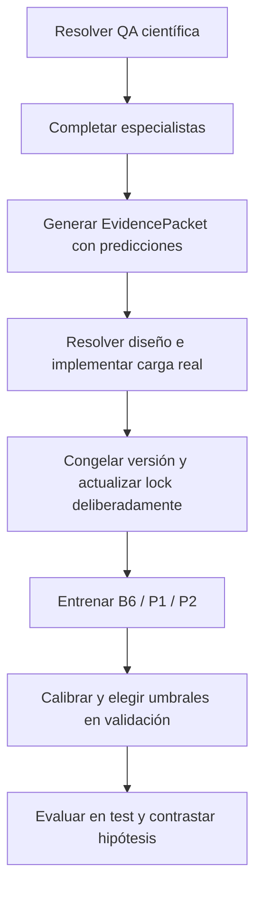

# Preparación del entrenamiento

Estado revisado durante la limpieza del 23 de octubre de 2026. Esta guía distingue ejecución de desarrollo, preparación de datos y evaluación científica.

## Qué puede ejecutarse hoy

Las pruebas y el entrenamiento `--data smoke` de [B6/P1/P2](../README.md). El cargador de `experiments/train.py` y `evaluate.py` solo acepta `smoke`: todavía falta implementar la carga del benchmark real. Cambiar un indicador de QA no habilita automáticamente esa carga.

## 1. Resolver los datos

En Repo A, revisar [QA](../../vehicle-claim-verification-baselines/docs/qa/FINAL_BENCHMARK_QA_REPORT.md):

- C2: revisión humana o exclusión documentada de sustituciones no identificables con la evidencia disponible.
- C3/C4/C5: fijar criterios y revisar validez/realismo de manipulaciones, incluyendo regiones pequeñas.
- Revisar atajos lingüísticos y dependencia entre variantes/donantes.
- Como test se utilizó durante el diseño, definir cómo obtener una evaluación confirmatoria adecuada.

Entrega: decisiones, criterios y registros de revisión explícitos; después, versión aprobada. No cambiar etiquetas automáticamente para que parezcan correctas.

## 2. Completar especialistas

- Narrativa: comprobar el extractor NLI sobre los relatos definitivos.
- Visual: preparar datos YOLO y entrenar/seleccionar checkpoint con separación por fuente; registrar configuración y procedencia de pesos. Existe `src/damage/train.py` en Repo A, pero su uso requiere un manifest fuente compatible; no pasarle directamente el manifest de reclamos.
- Forense: implementar un adaptador funcional y definir pesos/dependencias. Los antiguos archivos que solo contenían comentarios se retiraron; no existe aún un detector de manipulaciones.
- Crear un ejecutor reproducible de extracción y serialización de EvidencePacket por partición, preservando ausencia de evidencia y procedencia. Los paquetes congelados v2 con especialistas null no sirven como evidencia multimodal completa.

Entrega: paquetes con predicciones reales y trazabilidad. Las anotaciones usadas como evidencia perfecta pertenecen exclusivamente al control oracle.

## 3. Cerrar implementación y carga

Consultar [diferencias frente a la tesis](IMPLEMENTATION_STATUS.md). Resolver o declarar formalmente las simplificaciones: nodos, atributos continuos de arista, pesos por relación/residual/normalización y A4/A5. Precisar A5 considerando que C10 ya es solo test.

Implementar un cargador real compartido por train/evaluate: leer paquetes y labels separadamente, respetar splits congelados, rechazar contaminación entre fuentes y conservar condición/ID solo para auditoría y evaluación. Añadir verificaciones de integración que detecten fuga y paquetes inválidos.

Implementar además la orquestación de semillas/ensemble y comparaciones H1–H3; la existencia de fórmulas de incertidumbre o bootstrap no equivale a tener ese experimento ejecutado.

## 4. Congelar la entrada experimental

Mantener el mismo conjunto de paquetes, splits y protocolo para B6/P1/P2. Registrar commit, hashes, configuración, semillas y checkpoints. Actualizar `benchmark.lock.json` mediante `scripts/pin_benchmark.py` solo cuando se revise explícitamente la versión aprobada; actualmente fija v2. No quitar su control para hacer pasar pruebas.

## 5. Entrenar y evaluar

Primero validar una corrida corta sobre datos reales aprobados; luego ejecutar las semillas y comparaciones acordadas. Ajustar temperatura y umbrales solo en validación. Medir discriminación, calibración, riesgo/cobertura y condiciones de estrés sobre test. Agrupar intervalos y análisis por imagen fuente, considerando también donantes cuando corresponda.

Entrega: resultados reales reproducibles, intervalos y contraste de hipótesis. Un resultado nulo es un resultado válido.

## Reglas para evitar confusiones

- `SMOKE_RESULT`: datos sintéticos de desarrollo, nunca cifras de tesis.
- Código implementado ≠ modelo entrenado ≠ hipótesis evaluada.
- Sin evidencia suficiente, derivar a revisión; sospecha no demuestra fraude.
- No se inicia entrenamiento largo ni se descargan pesos durante la limpieza del repositorio.
